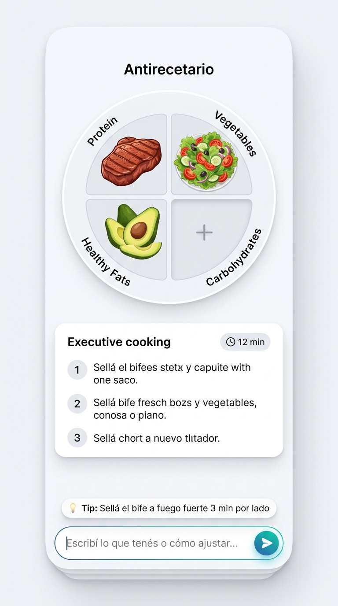
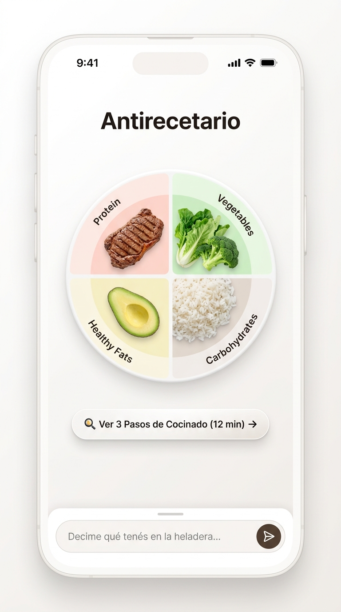
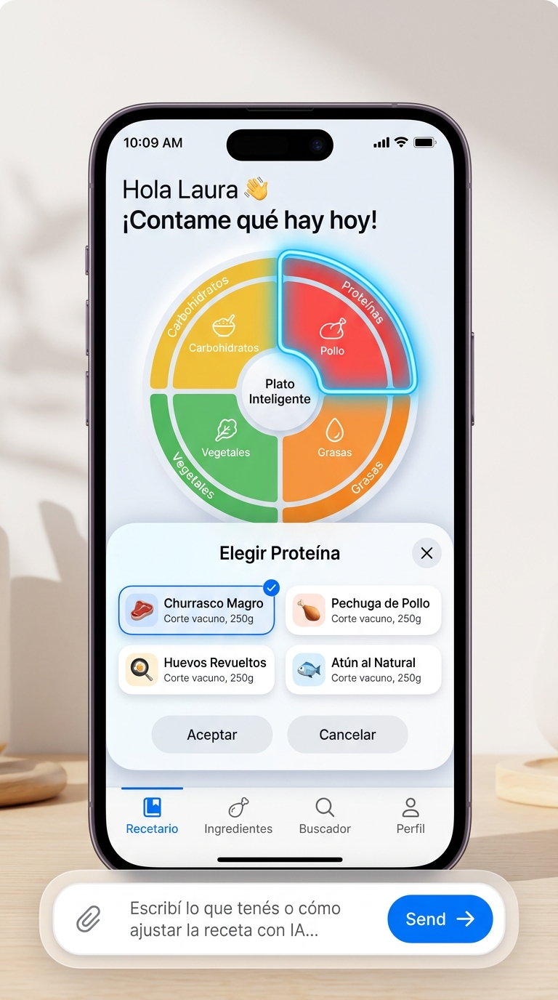

# Arquitectura y Diseño UX Mobile - Antirecetario

Este documento recopila las directivas de diseño mobile-first y las especificaciones de las tres variantes de interfaz evaluadas para la experiencia interactiva en teléfonos inteligentes.

---

## 1. Fundamentos Técnicos Comunes a Todas las Versiones

Independientemente del enfoque que se implemente, la interfaz mobile debe contar con los siguientes tres mecanismos para garantizar ergonomía en cocina:

### A. Viewport Dinámico contra el Teclado Virtual
* **Meta tag**: `<meta name="viewport" content="width=device-width, initial-scale=1.0, interactive-widget=resizes-content">`.
* **CSS Units**: Alturas basadas en `100dvh` (Dynamic Viewport Height) y flexbox.
* **Objetivo**: Evitar que el teclado virtual de Android o iOS (que consume ~45% de la pantalla) desplace la app fuera de vista o genere scrolls rotos.

### B. Colapso Reactivo del Plato (`:focus-within`)
* **Estado Normal (Teclado cerrado)**: El plato interactivo se visualiza en tamaño completo con sus 4 cuadrantes.
* **Estado Activo (Input de chat con foco / Teclado abierto)**: El plato se contrae automáticamente a una barra horizontal delgada con 4 chips de macronutrientes (`[🥩 Proteína] [🥗 Vegetal] [Carbo +] [🥑 Grasa]`) sobre el teclado.
* **Objetivo**: Que el usuario mantenga referencia continua de lo que tiene cargado mientras tipea.

### C. Entrada por Voz (Web Speech API)
* Micrófono integrado en la barra de chat inferior.
* Permite dictar ingredientes o modificaciones (*"Tengo bife y tomates"*, *"Cambiá la lechuga por rúcula"*) sin tocar la pantalla con manos húmedas o con restos de comida, evitando abrir el teclado virtual.

### D. Paradigma de IA Generativa de Canvas (Sin Burbujas de Chat)
* La IA no responde con párrafos de texto.
* La respuesta de la IA **es** la mutación directa de los cuadrantes del plato y los pasos de cocinado.
* Preguntas o recomendaciones puntuales se muestran en una píldora flotante efímera (*Callout del Chef*) de 1 a 2 renglones sobre el input, descartable con una `✕`.

---

## 2. Enfoques de Interfaz Evaluados

### Versión A: Canvas Vivo Compacto (Todo a la Vista)

* **Concepto**: Toda la información crítica (plato, 3 pasos de cocción y barra de chat) convive permanentemente en una sola pantalla sin necesidad de navegación ni paneles modales.
* **Distribución vertical**:
  1. *Header superior*: Título de la preparación y tiempo total (`⏱️ 12 min`).
  2. *Zona alta*: Plato circular interactivo (~200px) dividido en 4 cuadrantes táctiles.
  3. *Zona media*: Tarjeta horizontal condensada con los 3 pasos ejecutivos numerados (1, 2 y 3).
  4. *Zona baja*: Píldora de tip flotante + barra de chat fija con botón de micrófono y envío.
* **Ventajas**:
  * Visión completa de la receta de un solo vistazo.
  * No requiere clics adicionales para saber cómo cocinar.
* **Desventajas**:
  * Espacio más ajustado; el plato debe ser de escala moderada para evitar desbordes en pantallas chicas (≤ 390px).

---

### Versión B: Plato Protagónico + Modo Cocina Desplegable

* **Concepto**: El plato circular es el protagonista visual absoluto de la pantalla de armado. Los pasos de cocción se consultan a demanda mediante un "Modo Cocina".
* **Distribución vertical**:
  1. *Header superior*: Selector de temperatura (`🍲 Caliente / 🥗 Frío`) y tiempo estimado.
  2. *Zona central*: Plato interactivo grande y espacioso (~280px), optimizado para manipulación táctil cómoda.
  3. *Botón de acción flotante*: `[🍳 Ver 3 Pasos de Cocinado (12 min) ➔]`. Al tocarlo, se abre un drawer a pantalla completa con tipografía gigante, pensado para apoyar el celular en la mesada mientras se cocina.
  4. *Zona baja*: Barra de chat fija con micrófono y entrada de texto.
* **Ventajas**:
  * Interfaz sumamente limpia, visual y espaciosa.
  * Cuadrantes grandes y fáciles de presionar con los dedos.
  * El modo cocina a pantalla completa evita distracciones mientras se está frente al fuego.
* **Desventajas**:
  * Requiere un tap para acceder a las instrucciones de preparación.

---

### Versión C: Interacción Híbrida Táctil + Chat (Bottom Sheet)

* **Concepto**: Prioriza la interacción física con el plato para los usuarios que prefieren no escribir ni hablar.
* **Comportamiento**:
  1. Al tocar directamente cualquier cuadrante del plato (por ejemplo, *Proteínas*), el cuadrante se resalta con un halo visual y se despliega un **Bottom Sheet** (panel inferior deslizable).
  2. El Bottom Sheet muestra la biblioteca de opciones disponibles para ese macronutriente (ej. *Churrasco magro*, *Pechuga de pollo*, *Huevos revueltos*, *Atún*).
  3. Al seleccionar una opción con un toque, el panel se cierra y el plato se actualiza al instante.
  4. La barra de chat inferior permanece disponible para quien prefiera ingresar todo por texto o voz de forma libre.
* **Ventajas**:
  * Ofrece dos vías de uso equivalentes: selector visual rápido por taps o asistente de IA por chat/voz.
  * No obliga a abrir el teclado si el usuario solo quiere explorar opciones.
* **Desventajas**:
  * Mayor complejidad en transiciones de capas y estados entre el modal inferior y la barra de chat.
